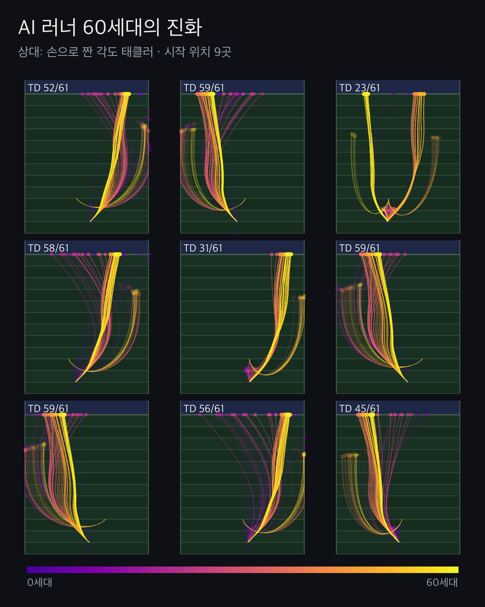

# Football AI

Teaching AI American football with **rewards only**: no plays, no rules of thumb, just "gain yards".
A vectorized 2D sim with movement limits fitted to real NFL tracking data, PPO, and self-play.
The whole process is logged experiment by experiment for a narrated video series.

> 보상만으로 AI에게 미식축구를 가르치고, 그 과정을 실험 하나하나 기록해 영상으로 만드는 프로젝트.

<p align="center"></p>
<p align="center"><sub>Same 9 starting setups, 61 generations of the AI runner drawn at once (purple = generation 0, yellow = generation 60).</sub></p>

## Experiments so far

| # | What | Result |
|---|---|---|
| [EXP-000](experiments/EXP-000-baseline-scripted/notes.md) | Bare 1v1 sim (runner vs tackler), scripted policies | Running straight scores 80%: discs pass through each other, no physics |
| [EXP-001](experiments/EXP-001-physics-and-tackling/notes.md) | NFL-fitted acceleration/braking/cutting, collisions (checked against Pymunk), probabilistic tackles | With momentum, a chasing defender overruns the runner. Taking an angle and breaking down drops straight-run TDs to 29% |
| [EXP-002](experiments/EXP-002-ppo-runner-v1/notes.md) | PPO runner vs the scripted tackler | 0% → 99% touchdowns in 2 generations (4 minutes). It found a hole in the tackler's prediction rule, not football |
| [EXP-003](experiments/EXP-003-selfplay-v1/notes.md) | Self-play: the tackler learns too | The champion runner drops 100% → 61% in one phase, then both sides stall near 60% (the 1v1 equilibrium). The tackler learned to wait in the runner's lane instead of chasing |
| [EXP-004](experiments/EXP-004-fine-gens-runner/notes.md) | Retrain with a checkpoint every 100k steps; draw all 61 generations at once on a colour gradient (`render/ghosts.py`) | The runner switched strategies mid-evolution (right side in gens 38-51, left from gen 52). Tackler that can't make the play just gives up and drifts to a corner |
| [EXP-005](experiments/EXP-005-delay-control/notes.md) | 0.2 s reaction delay + tackle control (overspeed / sidestep), compared to NFL pre-contact movement | Runner cuts reach NFL level (17-21° vs 19°) but nobody brakes. The tackler's learning collapsed: in ~1/3 of plays it runs away from the runner from the first step |
| [EXP-006](experiments/EXP-006-joystick-fix/notes.md) | Fix actions collapsing to 8 directions (SB3 clips each axis; widened the box) | Failed: tacklers learned to flee downfield 100% of the time, exploiting a loose breakaway rule against a runner that barely moved |
| [EXP-007](experiments/EXP-007-fixed-selfplay/notes.md) | Stricter breakaway rule, no untrained opponents in pools, plus a hand-written read-and-react tackler | First real arms race: the cross table forms a triangle (new generations beat old ones on both sides). Tacklers learned to pin runners to the sideline |
| [EXP-008](experiments/EXP-008-facing/notes.md) | Body facing (hips) measured from NFL tracking `o`: limited turn rate, slower moving away from where you face | First pre-contact braking: tacklers now brake before contact (median 2.5 yd/s², NFL 4.0). Runners still don't juke in open-field 1v1 |
| [EXP-009](experiments/EXP-009-3v3-screen/notes.md) | First 3v3: RB screen (RB + 2 OL vs LB + 2 DB) with blocking, OL speed calibrated to the combine | Defense wins the arms race (latest-vs-latest TD 84% → 42%), tacklers brake like NFL defenders (median 3.9 vs 4.0), one DB learns to play deep safety on its own |
| [EXP-010](experiments/EXP-010-blocker-shaping/notes.md) | Role reward for the blockers (potential-based shaping) | Failed: a bug in my shaping paid a bonus at timeouts, and the offense learned to send its blockers to the corners and run out the clock (71% timeouts) |
| [EXP-011](experiments/EXP-011-blocker-shaping-fixed/notes.md) | Same role reward, timeout bug fixed | Lost blockers 6% → 1%, but the offense is no stronger and the runner still rarely follows his blocks |

Each experiment folder has `notes.md` (hypothesis → attempt → result → surprises → next), `config.yaml`, metrics, and charts.
Daily log: [`devlog/`](devlog/). Plan and milestones: [`PLAN.md`](PLAN.md).

## How it works

- `sim/`: numpy sim batched over thousands of plays (~1M steps/s). Players are discs with speed-dependent push limits
  fitted from NFL Big Data Bowl 2027 tracking (`analysis/physics_from_bdb.py`; only aggregate numbers are stored).
- `train/`: Stable-Baselines3 PPO through a custom VecEnv (~100k training steps/s on a MacBook M1 Max CPU), self-play with opponent pools.
- `render/`: pixel-style MP4 clips (shorts 9:16 and episode 16:9) and generation-by-generation comparisons.

```bash
uv sync
uv run pytest
uv run python -m scripts.bench_env --all
uv run python -m train.train_runner --exp EXP-xxx --timesteps 10_000_000 --gens 10
uv run python -m render.clip --runner evasive --tackler angle --spread 8 --format shorts --out render/out/clip.mp4
```

## Honest limitations

- No running-back tracking exists in the data, so the ball carrier uses a wide receiver's body.
- Tackle success odds are an assumption (no contact data), currently missing more often than the real NFL.
- 1v1 on an open field is a toy. 3v3 with blockers comes next.

Data: NFL Big Data Bowl 2027 (CC BY-NC 4.0). The raw data is never committed. Team names and colors in the sim are fictional.
